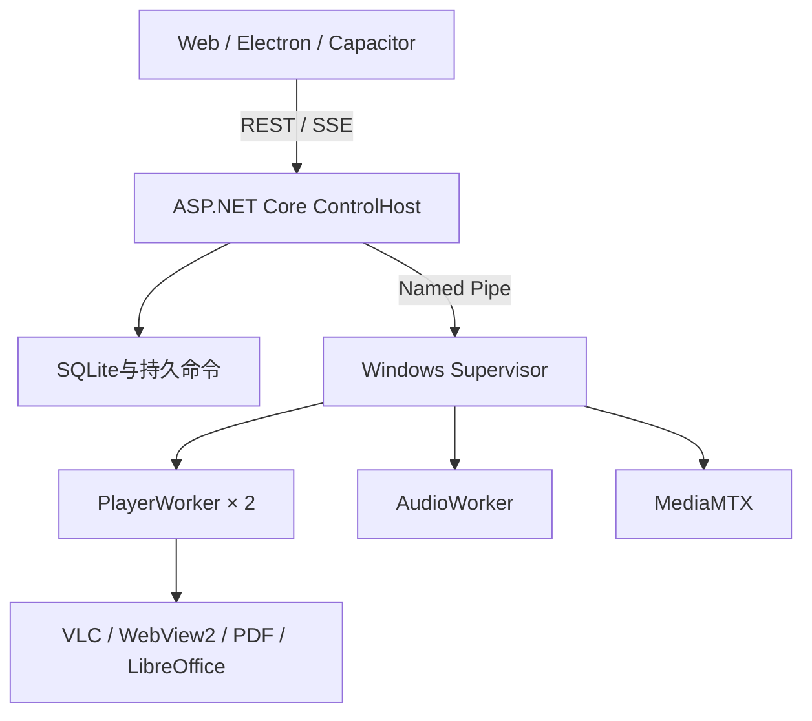

# SCP-cv

上海第二工业大学28#108多媒体显示控制平台。共享Vue控制台支持浏览器、Windows Electron和Android Capacitor；Windows播放服务提供两个大屏播放器、背景音乐、LibreOffice演示文稿播放及现场设备控制。

控制台：[HTTPS](https://192.168.5.194/)，HTTP80自动跳转HTTPS443。当前播放恢复和低延迟验证见[022记录](specs/022-playback-preview-recovery/verification.md)，输入分辨率见[维护说明](docs/input-resolution-021.md)。

## 架构



ControlHost负责业务数据库写入、认证和命令协调。播放进程按当前身份、组代次和来源代次执行命令。两个原生窗口绑定大屏输出，控制桌面保持可用；窗口3/4提供预览和输入选择。两台电视使用独立矩阵选源与电源控制。

浏览器预览由服务器按需转换并共享。Electron使用随包媒体组件从设备读取RTSP/RTMP。同一来源的多个预览共享传输和解码。

## 环境要求

- Windows10/11 x64交互桌面。
- 仓库`global.json`指定的.NET SDK，以及.NET Framework4.8运行时和开发组件。
- Node.js24、npm11.12.1；依赖版本由`package.json`指定。
- LibreOffice Windows x64及官方.NET互操作组件。
- VLC/libVLC、MediaMTX；服务器预览配置FFmpeg。
- uv，用于运行规范与QA辅助脚本。

依赖安装使用仓库`.npmrc`中的淘宝镜像。根目录与前端分别安装，Node锁文件按仓库约定保持忽略。

## 安装与构建

```powershell
dotnet restore runtime-dotnet/ScpCv.sln --locked-mode
dotnet build runtime-dotnet/ScpCv.sln -c Release --no-restore
npm install
npm --prefix frontend install
npm --prefix frontend run typecheck
npm --prefix frontend run build:web
```

第三方运行时位置：

- `tools/third_party/mediamtx/mediamtx.exe`。
- VLC/libVLC采用配置的Windows x64运行时。
- LibreOffice默认位于`C:/Program Files/LibreOffice/program`，可通过`SCP_CV_LIBREOFFICE_PROGRAM`指定。

## 开发运行

```powershell
dotnet run --project runtime-dotnet/src/ScpCv.ControlHost -- `
  --SafetyMode=Simulation `
  --urls=http://127.0.0.1:18000 `
  --DataRoot=.validation/dotnet

npm --prefix frontend run dev:web
```

前端连接设置见`frontend/.env.example`。Windows播放需要交互桌面和明确的显示器绑定；配置、凭据和实际启动操作见[维护文档](docs/维护文档.md)。

已有D4部署可使用桌面`SCP-cv 一键启动.cmd`。程序核对固定任务和文件身份，已有运行组保持运行。API提供`GET /api/runtime/`、`POST /api/system/restart/`和`POST /api/system/shutdown/`；写入请求携带认证会话和CSRF。

## 媒体与配置

- 媒体按照目录管理，上传保存原件；支持视频、图片、网页、音频和直播来源。
- PPT/PPTX由LibreOffice播放和转换，文字适配可在打开时选择，原件保持不变。
- 主组播分辨率与预览通道分别配置。软件支持D4四路4K输出，控制帧尺寸需要匹配当前输入的实际读回；设备尺寸见输入维护表。
- 屏幕共享需要安全连接，入口与证书设置见[屏幕共享文档](docs/screen-sharing.md)。

主要配置来自`runtime-dotnet/src/ScpCv.ControlHost/appsettings.json`和标准ASP.NET Core环境变量。账号口令使用受保护文件或配置环境变量，媒体URI中的凭据保持隐藏。

## 验证

```powershell
dotnet build runtime-dotnet/ScpCv.sln -c Release --no-restore
npm --prefix frontend run typecheck
npm --prefix frontend run build:web
uv run --no-project .specify/scripts/python/validate_specs.py --specs-dir specs
npm exec --package @redocly/cli -- redocly lint docs/openapi.yaml
git diff --check
```

功能验收使用实际服务、真实媒体和进程，记录实际画面、时钟、页码与释放结果。Windows播放器、LibreOffice、音频、共享预览和现场设备分别验证。软件控制帧的发送结果与实体画面证据分别记录。

## 数据与开发规范

运行数据默认位于`data/dotnet/`，验证资料位于`.validation/`。备份包括数据库、媒体、派生文件和部署配置。凭据、私钥、数据库、媒体、日志和构建产物保持本机存储。

开发约定见[AGENTS.md](AGENTS.md)、[CONTRIBUTING](CONTRIBUTING.md)和[STYLE](STYLE.md)。功能需求通过`specs/`中的规范、计划、任务和实际验收记录维护。

## 文档

- [使用文档](docs/使用文档.md)
- [维护文档](docs/维护文档.md)
- [OpenAPI](docs/openapi.yaml)
- [文稿运行指南](docs/libreoffice-playback.md)
- [设备操作与已知问题](docs/known-pitfalls.md)
- [变更记录](docs/CHANGELOG.md)

## 项目信息

开发者：Qintsg（饶弘玮）、young86（陈子阳）。使用地点：上海第二工业大学28#108。许可证：[Artistic License2.0](LICENSE)。
