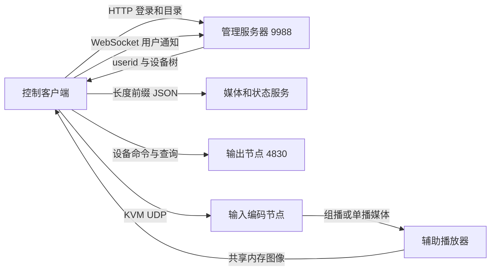

# 网络拓扑与生命周期

相关资料：[目录](README.md)、[HTTP](02-http-and-websocket.md)、[设备成帧](03-device-framing-and-crypto.md)。

## 地址的三种用途

| 地址 | 用途 | 来源 |
| --- | --- | --- |
| `webServerIp`／`netWebServerIp` | 用户登录、目录、收藏、配置与预案资料 | 本地 `ServerIp.ini` |
| `mediaServerIp` | 状态同步与媒体服务连接 | 本地配置；不等于登录地址 |
| 登录资料中的设备 `IP` | 输出节点控制目标 | HTTP 登录返回的 `VideoJoint[0].Area` |
| 输入的 `GroupIp`／`GroupPort` | 映射帧中的输入流地址 | `VideoJoint[0].Input` |
| IPC URL／摄像机 `IndexCode` | 相机或网关实际流资源 | 目录资料与 IPC／HTTP 代理 |

把登录服务器 IP、组播输入 IP 和输出节点 IP 混用，会产生“登录成功但预览或切换失败”。`127.0.0.1` 指运行该客户端的机器，不是现场服务器的别名。

## 实际配置目录

主程序的 `0x00401710` 拼接 `C:`、`CVS`、`VideoJoint`。`0x00404A20` 等函数在该目录拼接 `ServerIp.ini`，使用 Qt `QSettings` 的 INI 模式读写。

实际运行路径是 `C:/CVS/VideoJoint/ServerIp.ini`。E 盘安装目录同名文件的修改不会自动替代它。初次配置缺失时，程序会初始化 `row`、`column`、`webServerIp`、`mediaServerIp`、`netWebServerIp`、`MaxCount`、`PlayType` 和 `InitIni`。

本次登录失败时，运行配置的两个登录地址都是 `127.0.0.1`，本机 `9988` 无监听；现场 `192.168.5.200:9988` 的正确 POST 登录成功。两份配置备份后修正，用户确认重开客户端可以登录。`mediaServerIp` 没有随此修复改动。

## 已定位的通道

下表中的端口来自构造函数或实际调用，不代表所有服务当前都在线。

| 通道 | 默认／固定端口 | 证据 | 资料 |
| --- | --- | --- | --- |
| 管理 HTTP、登录 WebSocket | TCP `9988` | URL 常量；登录实测 | 02 |
| 会议关键帧辅助 HTTP | TCP `9999` | 辅助程序 URL 硬编码 `:9999/api/confcontrol/…` | 02、05 |
| 输出节点控制 `CTcpSocket` | TCP `4830` | `0x007027E0` 的 `0x12DE` | 03、04 |
| 另一设备／本地转发入口 | `4840` | 设置调用与 `0x0070A460` 的 `127.0.0.1:0x12E8` UDP | 04、07 |
| `CTcpClient` 中控／状态连接 | TCP `7778` | `0x006EFB20` 的 `0x1E62` | 07 |
| `CTcpRecvFile` 状态资料 | TCP `9997` | `0x00702490` 的 `0x270D` | 07 |
| IPC 服务 | TCP `8070` | `0x007110D0` 的 `0x1F86` | 06 |
| IPC／ONVIF 代理 | TCP `9996` | `0x00713AA0` 的 `0x270C` | 06 |
| UDP 远程输入接收 | UDP `63430` | `0x007118B0` 的 `0xF7C6` | 06 |
| Dante 相关发送 | UDP `5062` | `0x00717A20` 的 `0x13C6` | 06 |
| 报警事件通道 | UDP `8932` | `0x0071D530` 的 `0x22E4` | 06 |
| 摄像机辅助报文发送 | UDP `9998` | `0x0071FC60` 的 `0x270E` | 06 |
| 软录制发送／接收 | UDP `9888`／`9889` | `0x00720370`／`0x00720250` | 06 |
| 国标节点 WebSocket | TCP `10056` | `ws://…:10056` | 02 |
| 工程发现 | UDP `9999` | `0x0077DD60` | 07 |
| 工程接收 | TCP `20202` | `0x0077E040` 的 `0x4EEA` | 07 |
| 视频／音频输入 | 来自目录，现场多为 `5000` | `GroupPort`，播放器绑定值 | 05 |
| KVM DLL 的 UDP 目标 | 由 `setUDPIp` 传入 | 导出函数与发送对象字段 | 06 |

`CvsControlServerIp`、`DevInfoServerIp`、`AudioRecServerIp` 等服务的部分连接端口仍需沿所属构造函数补齐；不能因为名称相似，就把上表某个端口移给另一个服务。

## 配置开关与协议选择

| 开关 | 可确认的影响 |
| --- | --- |
| `IsUseNoServer` | 控制是否走无服务资料路径；不是设备 TCP 认证开关 |
| `IsUseNewProtocol` | 设备 TCP 发送／接收切换到 DES 外层；参见 03 |
| `UseIpcServer`、`ConnectIpcServer` | 控制 IPC 服务使用与连接 |
| `PlayType` | 安装说明标为组播、单播、RTMP 三种预览方式；当前辅助程序也支持 RTSP URI，不能只看程序名判断传输 |
| `SendType` | 安装说明标为组播、单播、组播与单播组合；具体分支与型号相关 |
| `MaxCount` | 客户端支持的开窗数量配置；不是已经读回的硬件能力 |
| `ScreenRow`、`ScreenColumn`、`IsSignalScreen` | 客户端显示／控制布局配置；与服务器的墙面物理行列分别核对 |
| `PreviewConnectType` | 辅助播放程序的 RTSP 连接选择分支；参见 05 |

## 登录后不是一条连接

HTTP 成功只证明账号和目录链路有效。设备控制包、输入媒体、共享内存、IPC 和 KVM 都有各自的连接与失败状态。

## 当前现场配置核对

2026-10-08 登录响应中的墙面为 5 行、10 列，逻辑分辨率 `19200*5400`。50 个位置与项目节点算法完全相符，包括原实现的 45／46 互换。工作站 2 的两个既有输入是 `224.1.1.55:5000`、`224.1.1.56:5000`，目录分辨率均为 `3840*2160`。

这是服务器资料和项目配置的核对结果；实体屏幕的网线、地址和画面还需要独立观察。详见 [08](08-audit-and-verification.md)。
